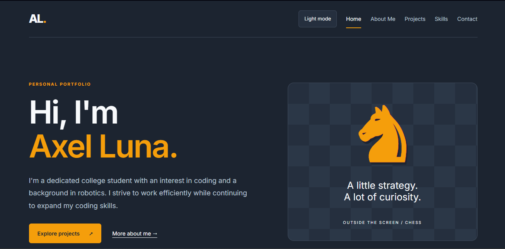
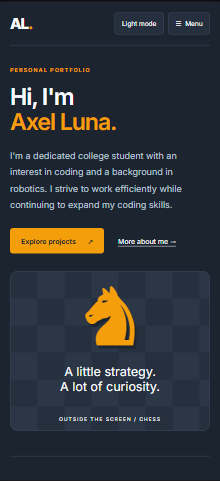

Repository: [https://github.com/AxelLLn580/Portfolio](https://github.com/AxelLLn580/Portfolio)

Live website: [https://axellln580.github.io/Portfolio/](https://axellln580.github.io/Portfolio/)

# Personal Portfolio Project Report

Axel Luna

## Website features

My portfolio is a five-page website built with HTML, CSS, and JavaScript and hosted on GitHub Pages. The Home page introduces me as a college student interested in coding with a background in robotics. About Me describes my childhood in the Dominican Republic, move to the United States, automotive education, robotics club experience, and interests in chess and video games.

The Projects page presents three Python programs, each with a Google Colab link. Inventory Management tracks a small store's stock, calculates inventory value, and updates prices; its card includes a dashboard illustration. API Joke Fetcher has a live browser demo that requests a joke and hides the punchline until the visitor clicks the setup. Rock-Paper-Scissors includes a two-player demo with private choices, a handoff between players, a result, and a replay button. The browser demos use JavaScript adaptations of the Python programs.

The Skills page summarizes Python fundamentals, APIs, file handling, Google Colab, robotics teamwork, and automotive education. The Contact page reveals my email address when requested. Shared features include a saved light/dark theme preference, responsive layouts, a mobile navigation menu, a skip link, and keyboard focus indicators.

## Challenges and solutions

One challenge was presenting notebook programs on a static website. GitHub Pages serves static files, so the demos implement the programs' behavior in JavaScript. The joke demo uses the same API as the Python version, with a timeout, loading message, and retry message. The game preserves the notebook's two-player rules and hides Player 1's selection before Player 2 chooses.

Another challenge was accessing Google Colab through Codex's tools. Direct access failed, so I saved the notebooks in the project folder. Codex could then inspect their code and base the demos on the actual programs. This also helped keep project descriptions accurate.

The layout also needed to work on different screen sizes. CSS media queries change the Home page from a side-by-side introduction and chess illustration to a stacked phone layout. On smaller screens, the navigation uses a Menu button. The screenshots below show these differences.

## A Codex mistake and its correction

Codex initially saved my Home page introduction in the separate `AxelLLn580.github.io` repository instead of the working `Portfolio` repository. I noticed that the preview did not show the change and asked why. Codex inspected both folders, identified the wrong repository, undid the misplaced edit, and applied the introduction to `Portfolio/index.html`. The repository guidance in `AGENTS.md` explicitly identifies the correct working folder so future edits can start by checking the repository root.

## Verification and documentation

The repository includes `AGENTS.md`, `TESTING.md`, and a README containing the project description, live URL, local viewing instructions, and acknowledgments. Whitespace checks passed during editing. Simulated JavaScript checks covered joke loading, punchline reveal, reset and error behavior, plus all nine rock-paper-scissors choice combinations. These checks verify logic; they are not a complete browser or accessibility audit. `TESTING.md` retains dated live-site checks and clearly marks browser tests that were not run.

## Laptop and phone screenshots

Laptop: the navigation is visible across the header, and the introduction and chess illustration appear side by side.

Phone: the navigation collapses into a Menu button, while the introduction, links, and illustration stack vertically.
